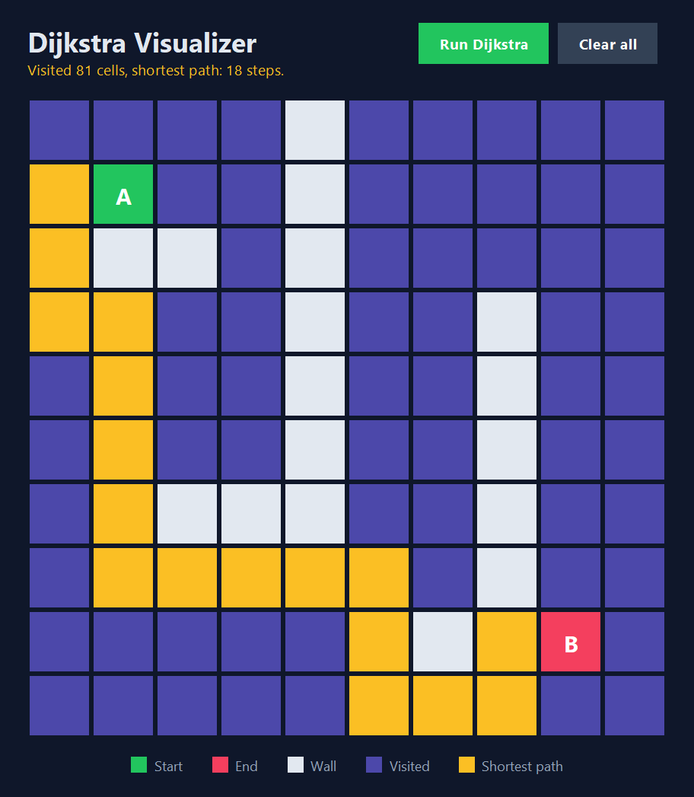

<div align="center">

# 🗺️ Dijkstra Visualizer

Programa en Java que muestra, paso a paso, cómo el algoritmo de Dijkstra encuentra el camino más corto en una grilla.



</div>

## ¿Qué hace?

La grilla tiene un punto de inicio **A** y un destino **B**. Tú dibujas muros y el programa busca la ruta más corta entre los dos puntos esquivándolos. Mientras busca, pinta cada celda que revisa; al terminar, marca el camino encontrado.

## Cómo ejecutarlo

Necesitas **Java 22 o superior**.

```bash
javac -d out src/*.java
java -cp out Main
```

También puedes abrir el proyecto en IntelliJ IDEA y ejecutar `Main`.

## Cómo usarlo

1. Haz clic en una celda para poner un muro, o arrastra para dibujar varios. Haz clic otra vez para quitarlo.
2. Presiona **Run Dijkstra** para iniciar la búsqueda.
3. Presiona **Clear all** para limpiar la grilla.

Arriba se muestra el resultado: cuántas celdas se revisaron y cuántos pasos tiene el camino, o un aviso si no hay forma de llegar a B.

## Colores

| Color | Significado |
|---|---|
| 🟩 Verde | Inicio (A) |
| 🟥 Rojo | Destino (B) |
| ⬜ Gris claro | Muro |
| 🟪 Morado | Celda revisada |
| 🟨 Amarillo | Camino más corto |

## ¿Cómo funciona el algoritmo?

Cada celda está conectada con sus cuatro vecinas (arriba, abajo, izquierda y derecha) y moverse a una de ellas cuesta 1 paso.

1. A tiene distancia 0 y todas las demás celdas empiezan con distancia infinita.
2. Se toma la celda no revisada que tenga la menor distancia y se marca como revisada.
3. Si llegar a una vecina por esta celda es más corto que lo que se sabía, se actualiza su distancia y se recuerda de dónde vino.
4. Se repite hasta revisar todo lo alcanzable. Luego, desde B se sigue hacia atrás el rastro de "de dónde vino" hasta llegar a A: ese es el camino más corto.

## Archivos

- `src/Main.java`: inicia el programa.
- `src/DijkstraVisualizer.java`: ventana, grilla, algoritmo y animación.
